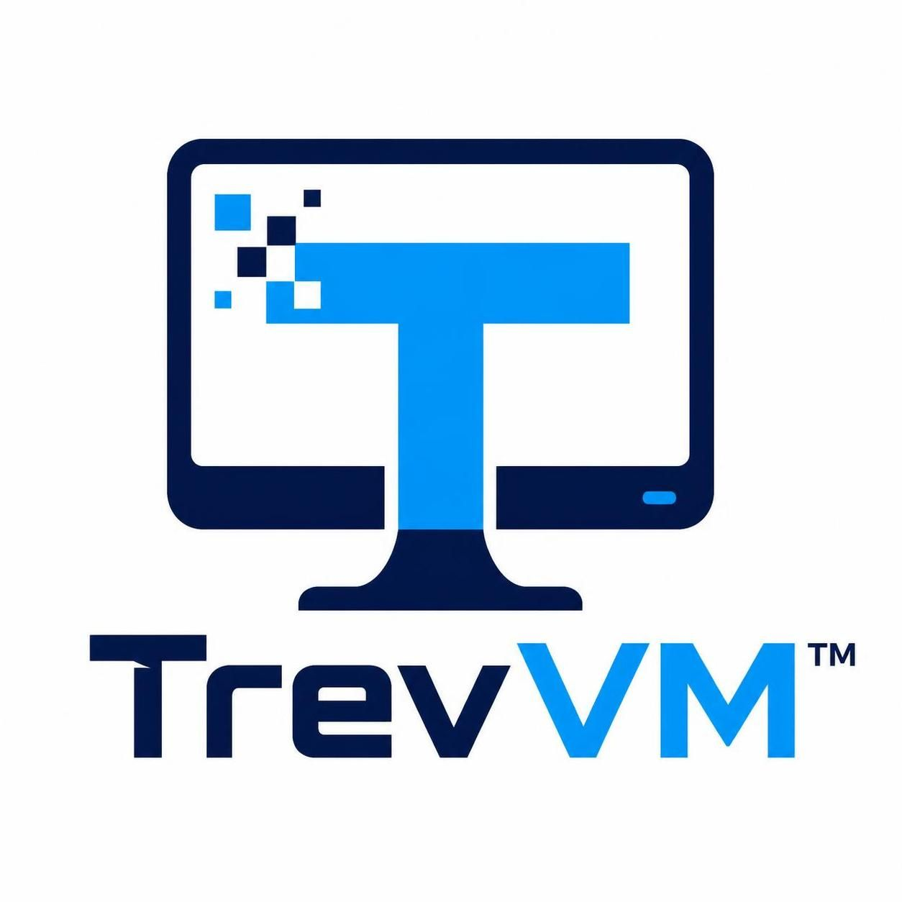

# TrevVM

A Linux desktop that runs in a container and streams to your browser through
KasmVNC. It is built for GitHub Codespaces, but any Docker host with enough
memory and disk works.

## Quick start (Codespaces)

1. Fork this repository and create a codespace on `main`.
2. Run the installer in the codespace terminal:

```bash
git clone https://github.com/AZumyov/TrevVM.git
cd TrevVM
./install.sh
```

The installer asks which desktop and apps you want, builds the image, starts
the container, and prints the URL. The first build usually takes 10-30 minutes.

A plain `docker build .` also works; it produces Cinnamon with no optional
apps. The installer passes your selection to the build as a build argument.

### One-liner

```bash
curl -fsSLO https://raw.githubusercontent.com/AZumyov/TrevVM/main/install.sh
TREVVM_REPO=AZumyov/TrevVM bash install.sh
```

`TREVVM_REPO` defaults to the upstream `TrevorTesch/TrevVM`; set it to your
fork if you want your own changes. When `install.sh` runs from inside a
checkout, that checkout is used and nothing is cloned.

## Requirements

* Docker Engine or Docker Desktop (the Codespaces image already includes it).
* 2 vCPU and 4 GB RAM minimum; 4 vCPU and 8 GB recommended.
* About 10 GB of free disk for the image and save data.
* `/dev/kvm` is optional. The installer detects it and only passes it through
  when it is usable.

## Installer options

| Flag | Meaning |
| --- | --- |
| `-y`, `--yes` | Use the default selection without the TUI. |
| `--de ID` | `cinnamon`, `xfce`, `kde`, `i3`, `gnome` or `lxqt`. |
| `--apps LIST` | Comma separated package ids (`python3 installer.py --list`). |
| `--all`, `--none` | Select every package or no optional packages. |
| `--port PORT` | Host port for the desktop, or `auto`. |
| `--kvm`, `--no-kvm` | Override KVM detection. |
| `--save PATH` | Save directory (default: `./Save`). |
| `--dry-run` | Check the host and print the plan without changing anything. |
| `--update` | Pull, rebuild and recreate the container, keeping save data. |
| `--reinstall` | Rebuild and recreate without pulling. |
| `--status` | Show container, health, URL and save path. |
| `--uninstall [--purge]` | Remove the container; `--purge` also removes the image and save data. |
| `--no-cache` | Rebuild without Docker's layer cache. |

Useful environment variables: `TREVVM_CONTAINER`, `TREVVM_IMAGE`,
`TREVVM_PORT`, `TREVVM_SAVE`, `TREVVM_TZ`, `TREVVM_REPO`, `TREVVM_BRANCH`.
`TREVVM_USER` and `TREVVM_PASSWORD` enable KasmVNC basic authentication.

## Docker Compose

```bash
docker compose up -d --build
```

Compose builds the same image with Cinnamon and no optional apps. Use
`./install.sh` when you want to choose a desktop or apps.

## Managing the VM

```bash
./trevvm.sh status
./trevvm.sh start | stop | restart
./trevvm.sh logs -f
./trevvm.sh shell
./trevvm.sh update
./trevvm.sh backup              # backups/trevvm-backup-*.tar.gz
./trevvm.sh restore FILE
./trevvm.sh reset               # wipe save data, restore defaults
./trevvm.sh doctor              # docker, KVM, port, disk, save checks
./trevvm.sh uninstall [--purge]
```

## Adding apps without rebuilding

Every package in `apps.json` is available inside the running container:

```bash
./trevvm.sh apps list
./trevvm.sh apps install vlc
```

The app log is written to `Save/trevvm-apps.log`.

## Accessing the desktop

Open the **Ports** tab in Codespaces and open port `3000`, or use the URL the
installer prints:

```
https://<codespace-name>-3000.<forwarding-domain>
```

Make the port private unless you are the only person who can reach it.
KasmVNC starts without authentication; set `TREVVM_USER` and
`TREVVM_PASSWORD` before installing if you need a login prompt.

## Panic key

`panicpress.js` is an optional browser-side snippet. It is not loaded by the
image. Paste it into the DevTools console on the KasmVNC tab, or save it as a
bookmarklet:

```js
javascript:(function(){/* contents of panicpress.js */})()
```

Press `=` to jump to `https://www.google.com`. Override the destination with
`window.TREVVM_PANIC_URL` before pasting. The script ignores typing inside
inputs, so it does not fire while you are editing a text field.

## Updating

```bash
./trevvm.sh update
```

That runs `git pull --ff-only` in a checkout, rebuilds the image, and recreates
the container. `Save/` is never deleted by an update.

Manual equivalent:

```bash
git pull --ff-only
./install.sh --update
```

## Uninstall

```bash
./trevvm.sh uninstall          # keeps Save/ and the image
./trevvm.sh uninstall --purge  # removes Save/ and the image too
```

## Troubleshooting

See [docs/TROUBLESHOOTING.md](docs/TROUBLESHOOTING.md). Start with:

```bash
./trevvm.sh doctor
./trevvm.sh logs --tail 100
```

## Security

The desktop is a full Linux session. Anyone who can reach port `3000` can use
it. Set `TREVVM_USER` and `TREVVM_PASSWORD`, keep the forwarded port private,
and do not expose it on an untrusted network. The container runs with
`seccomp=unconfined` (a KasmVNC requirement) and optionally with `/dev/kvm`.


## Community

* [Wiki](https://github.com/TrevorTesch/TrevVM/wiki)
* [Discussions](https://github.com/TrevorTesch/TrevVM/discussions)
* [Upstream project](https://github.com/TrevorTesch/TrevVM)

TrevVM is Apache-2.0. Follow the repository's code of conduct and security
policy when reporting issues.

## License

Apache-2.0. TrevVM is based on the LinuxServer.io KasmVNC base image and the
original [TrevVM](https://github.com/TrevorTesch/TrevVM) project.
